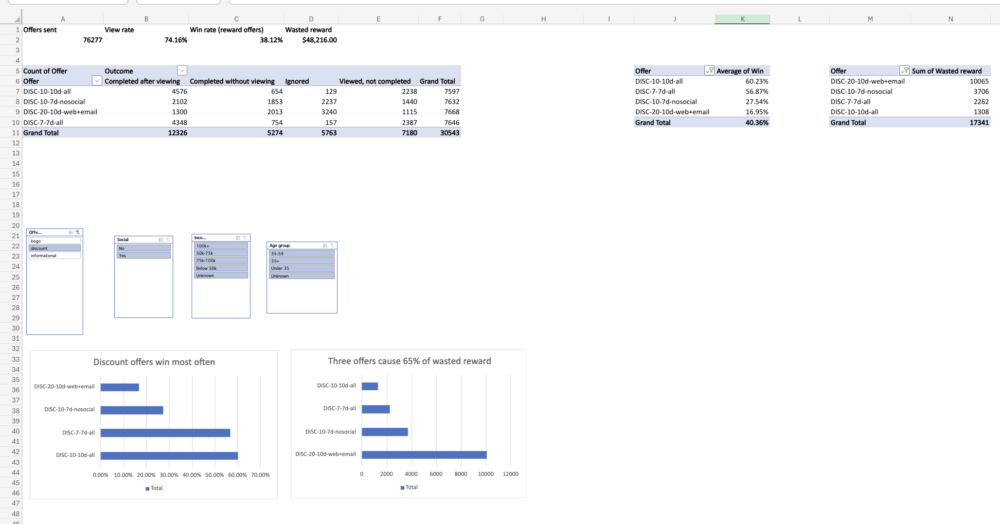

# Starbucks Rewards: offer performance and targeting

Did promotional offers drive purchases, or did reward go to customers who would have bought anyway?

## Findings

- **29.7% of completions happened before the customer viewed the offer.** That is $48,216 of the $162,426 paid in reward.
- **Three offers cause 65% of that waste** ($31,580): BOGO-5-7d-nosocial, BOGO-10-7d-noweb and DISC-20-10d-web+email.
- **Offers sent without the social channel were viewed 47% of the time, vs 94% with it.** The three no-social offers were 38% of reward sends but 51% of wasted reward.
- **Easy all-channel discounts win most:** DISC-10-10d-all wins 60.2%, DISC-7-7d-all 56.9%. The hardest offer, DISC-20-10d-web+email, wins 17.0%.
- **Customers with no profile almost never respond to BOGO** (16% win rate or less), but easy discounts still win 26–31% with them.

## Recommendations

1. Retire DISC-20-10d-web+email.
2. Add the social channel to BOGO-5-7d-nosocial and DISC-10-7d-nosocial.
3. Send BOGO to known customers; send easy discounts to new members and customers with no profile.
4. Run a 90/10 holdout test before scaling ([test plan](outputs/holdout_test_plan.md)). Customers spent $4.80 a day while a viewed offer was running vs $1.71 with none, but that is a correlation, not proof.

## Data checks

10 checks, all logged in the Quality log sheet. The two that changed the numbers:

- The offer ID is stored under two keys ("offer id" and "offer_id"). Reading one would have dropped every completion.
- 477 offers were completed twice by one purchase. Matching each event to the latest copy received fixed the double count: 33,101 + 478 extra = 33,579 raw completions.

## Method

- Loaded three JSON files (10 offers, 17,000 customers, 306,534 events) into DuckDB.
- Built one row per offer received (76,277) with its validity window, and matched each view and completion to it with an ASOF join.
- Labelled each offer: ignored, viewed not completed, completed after viewing (a win), or completed without viewing (wasted reward).
- Split customers by income, age and membership length; every offer × segment cell has 200+ offers.

## Files

| File | What it is |
|---|---|
| `scripts/step2_load.py` … `step10_export.py` | SQL analysis, run in order |
| `outputs/offer_dashboard.xlsx` | Dashboard with slicers, Quality log, Offer tracker, Segments |
| `outputs/offer_performance_deck.pdf` | 8-slide summary |
| `outputs/holdout_test_plan.md` | Test design for BOGO-5-7d-nosocial |

## Run it

python3 -m venv venv
source venv/bin/activate
pip install -r requirements.txt
python scripts/step2_load.py

Data: Starbucks Rewards simulated app data (Udacity capstone), placed in `data/`.

Tools: Python, DuckDB (SQL), pandas, Excel.
